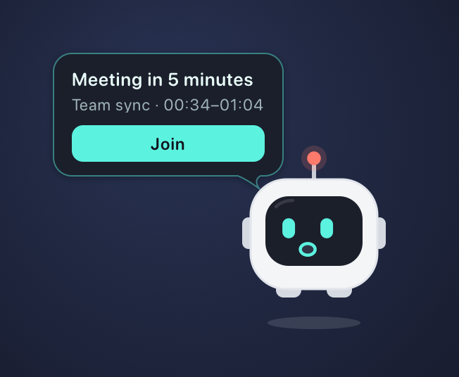
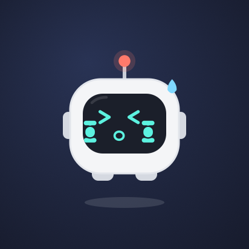
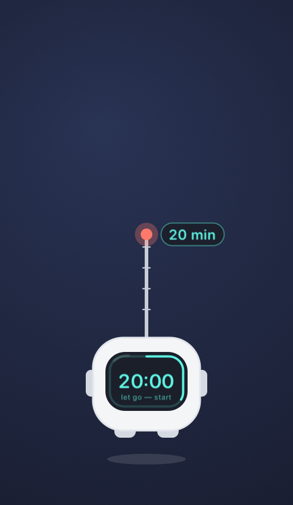
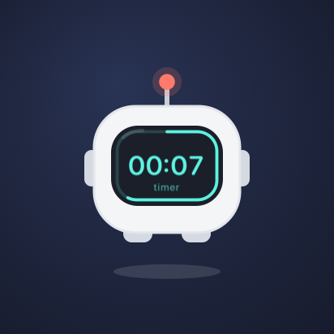
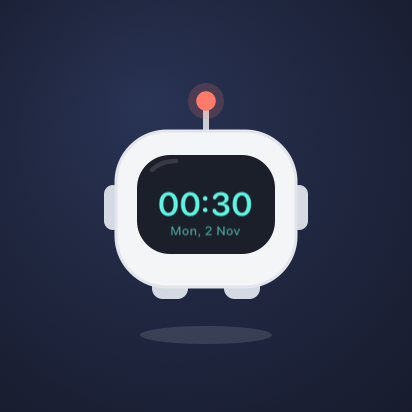
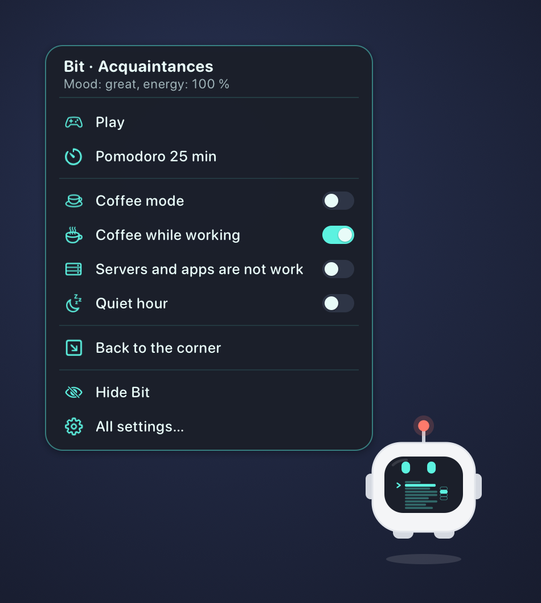

# MyPetBit

[Русский](README.md) · **English** · [简体中文](README.zh.md)

Bit is a tiny monitor-robot that lives on your macOS desktop: it follows the cursor with its eyes, cheers up,
falls asleep when you step away, and notices what is going on with your computer and your work — from a dying
battery to Claude finishing an answer or a build that just failed.



**Everything stays on your Mac.** Bit never goes online and sends nothing anywhere — details in
[What Bit reads and what leaves your Mac](#what-bit-reads-and-what-leaves-your-mac).

---

## What it does

**Lives its own life.** Floats, blinks, watches the cursor; when bored it reads, plays Tetris and racing games,
boxes, lifts dumbbells and celebrates a win. A character with affection, mood and energy; it dresses itself —
glasses, a scarf, a mug, and in season a pumpkin hat or a Santa hat. Pet it with the cursor and it purrs through
the trackpad.

| | | | |
|:-:|:-:|:-:|:-:|
|  |  |  |  |
| reading | Tetris | boxing | dumbbells |
|  |  |  |  |
| petted | sleeping | working | coffee |

**Feels the computer.** Battery, charging, overheating, low memory and disk, network and VPN, calls (it turns
translucent and stays quiet), music, headphones, screenshots, downloads — a short reaction and a badge on its screen. If a calm Mac suddenly gets busy — CPU jumps, memory
fills up or disk space is going fast — Bit says so, names the heaviest process and shows CPU, RAM and disk in percent.

**Works alongside you.**
- While an AI agent is answering — **Claude Code, Cursor, OpenCode, Ollama, Codex, Kimi** — Bit is “working”, then
  says “Claude has answered” with the session name; when the agent asks for permission, a hand shows on its screen.
- **Long terminal commands:** “Command finished” or “Command failed · exit code 1”, and the button takes you to that
  very tab. A running command can be stopped from Bit's menu.
- While work is going on, the display stays awake and Bit holds a coffee.

**Keeps your rhythm.** Pomodoro and a timer on Bit's screen — set it by pulling the antenna; a clock on hover;
Calendar meetings 5 minutes ahead and at the start with a Join button; reminders for breaks, water and eyes
(20-20-20); a day summary in the evening; a quiet hour.

| | | |
|:-:|:-:|:-:|
|  |  |  |
| pull the antenna — minutes | timer | clock on hover, click — CPU, RAM and disk load |

**A menu in its own style.** A two-finger click on Bit opens a card with the essentials, and the same items appear
as lines on Bit's screen. The menu bar menu keeps only the essentials (timer, quiet hour, coffee, tidying the desktop);
everything else is in a Settings… window in the same style: reactions, work, rhythm, permissions, desktop, character.

**Carries files.** Drag one or more files onto Bit — “Caught it!” — and it holds them (the files stay where they are
for now). Drag a file off Bit into any folder or onto the desktop and the file moves there. A two-finger click on Bit
while it holds files opens quick actions: put on the Desktop, in Downloads or a chosen folder, compress to ZIP, unpack,
“Convert to…”, open, show in Finder, AirDrop, move to Trash or let go.

**Converts.** Documents (odt ⇄ docx ⇄ rtf ⇄ html ⇄ txt, to PDF), Markdown (to docx, odt, html, PDF), presentations and
spreadsheets (pptx → PDF), images (jpg ⇄ png ⇄ heic, to PDF, shrink), PDF (compress, merge, pages to PNG), video
(compress to HEVC or H.264, to GIF, audio to M4A) and audio. Bit picks the best of what your Mac has: macOS itself;
Keynote, Pages and Numbers with layout; LibreOffice, pandoc, ffmpeg, libwebp, ImageMagick if installed (which ones were
found and how to install the rest — Settings → Converters). Nothing is bundled inside Bit.

**Controls music.** Hold Bit for half a second — pause or play; swipe two fingers on the trackpad over it to the left —
next track, to the right — previous. Bit's screen shows the symbol and the title, and after a switch it names the new
track. The same is in the two-finger menu. Works with any player that tells the system what is playing.

**Hides and tidies up.** “Hide” — Bit waves and flies off the top of the screen, then comes back to its spot in 10 or
30 minutes, an hour, two (or when you call it). Ask it to “Tidy the desktop” and it lines up files and folders on a
grid; arrange them yourself and choose “Remember where the icons are” — from then on it puts them back like that.
A timer can have a name and keep coffee mode on while it runs.



On first launch Bit flies into the middle of the screen, waves and introduces itself: five pages about what it does,
then permissions and initial settings. To see it again — “Introduction…” in Settings.

The interface speaks Russian, English and Chinese (following the system language).

---

## About signing — up front

> The project has no paid Apple Developer account, so the app is not notarized. On someone else's Mac, Gatekeeper
> will block it by default. The reliable way is to **build from source** (`make install`): a build made on your own
> machine raises no questions, and you see the code you run. If you install from the disk image, remove the
> quarantine with the command below after copying.

## Installation

**From source (recommended).** You need macOS 14+ and the Command Line Tools (`xcode-select --install`); Xcode is not required.

```bash
git clone https://github.com/TruDevLab/MyPetBit.git
cd MyPetBit
make cert      # once: your own signing certificate, so macOS permissions survive rebuilds
make run       # build, install to /Applications and launch
```

**From the disk image.** Download `MyPetBit-<version>.dmg` from the Releases page, drag MyPetBit to Applications and
remove the quarantine:

```bash
sudo xattr -r -c /Applications/MyPetBit.app
```

The command removes extended attributes from this one app only and turns nothing else off. To check the signature:
`codesign --verify --deep --strict /Applications/MyPetBit.app` — silent if everything is fine.

Bit lives in the menu bar; it has no Dock icon.

**Updates.** Once a day Bit checks GitHub releases; it downloads a new version, verifies the checksum and the signature,
and offers “Update” in a bubble — it replaces itself and relaunches, no password needed. A copy built without `make cert`
doesn’t update itself: Bit gives you a link to the image.

## Connect AI agents and the terminal

The easy way is a button: **Settings → Integrations → “Connect everything found”** (or in the introduction). Bit writes its
hooks into the agents it finds and into `~/.zshrc`, touches only its own entries and leaves a `.bak-mypetbit` copy before
the first change; move the app and it fixes the paths itself. By hand — templates in [`integrations/`](integrations),
pointing to `/Applications/MyPetBit.app`.

| What | Where |
|---|---|
| Claude Code | the `hooks` block from `integrations/claude/settings.json` → `~/.claude/settings.json` |
| Cursor | `integrations/cursor/hooks.json` → `~/.cursor/hooks.json` |
| OpenCode | `integrations/opencode/mypetbit.js` → `~/.config/opencode/plugins/` |
| Codex | the line from `integrations/codex/config.toml` → `~/.codex/config.toml` |
| Kimi CLI / Kimi Code | the blocks from `integrations/kimi/config.toml` → `~/.kimi/config.toml` or `~/.kimi-code/config.toml` |
| Ollama | nothing: Bit sees the model answering from its process load |
| Terminal (exit code) | `source "/path/to/MyPetBit/tools/mypetbit.zsh"` in `~/.zshrc`; without it Bit still notices long commands, just without the exit code |

Any script can make Bit say something: `/Applications/MyPetBit.app/Contents/MacOS/MyPetBit --say "Build is ready"`.

## What Bit reads and what leaves your Mac

**Nothing about you leaves:** there is no telemetry or analytics. The only network request is a daily check with GitHub
for a new version (`api.github.com/repos/TruDevLab/MyPetBit/releases/latest`, nothing about you is sent); turn it off in
Settings → Bit → Check for updates. A file leaves only if you send it via AirDrop yourself. Everything Bit learns stays in
the process memory and in its settings (`~/Library/Preferences/com.trudevlab.mypetbit.plist`).

What it reads in order to react:
- **system readings** — battery, CPU load, network, disk space, camera and microphone (only whether they are on,
  never the picture or sound), the audio output device;
- **the clipboard** — only the change counter and data types, never the content;
- **your user's processes** — to notice a long terminal command and Ollama's load; command names and arguments are
  shown only in the bubble;
- **the Claude Code session log** — the tail of the file, to take the session name;
- **what is playing** — title, artist and player, via the built-in helper (only to show the track and control it);
- **with your permission:** Calendar (meetings in the next few minutes), the Downloads folder (names of new files),
  Accessibility (only the typing pace, not the keys), control of Terminal or iTerm (to switch to the tab when you
  press Open) and of Finder (to arrange desktop icons when you ask). All of these are off until you turn them on.

## Requirements and limitations

- macOS 14 Sonoma or later. The disk image is for Apple Silicon; on Intel, build from source.
- Trackpad haptics are felt only on a Force Touch trackpad and only with a finger on it.
- A command's exit code is known only with the zsh hook; other shells are tracked by process, without the code.
- Codex reports only the end of an answer, so “working” is not shown for it. The Kimi chat app has no hooks.
- Without your own certificate (`make cert`), macOS asks for permissions again after every rebuild.
- Music control uses the private MediaRemote framework: since macOS 15.4 it only answers processes whose identifier starts
  with `com.apple.controlcenter.`, so Bit carries a small helper with such an identifier (like Trunook does). If Apple
  closes this too, only music control stops working.
- Conversion uses what your Mac has: pptx needs Keynote or LibreOffice, mkv and webm need ffmpeg.

## Development

How everything works, every reaction and the debugging flags — in [DEVELOPMENT.md](DEVELOPMENT.md) (in Russian).
`make test` runs the logic tests. Translations: the key is the Russian string, translations live in
`Resources/en.lproj` and `Resources/zh-Hans.lproj`.

## License

[MIT](LICENSE).
