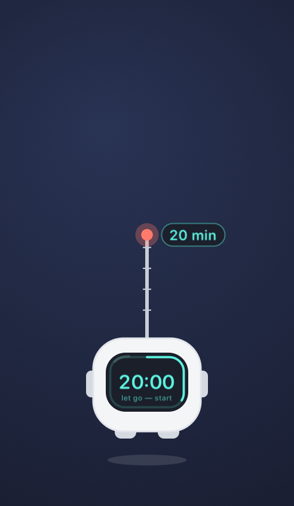
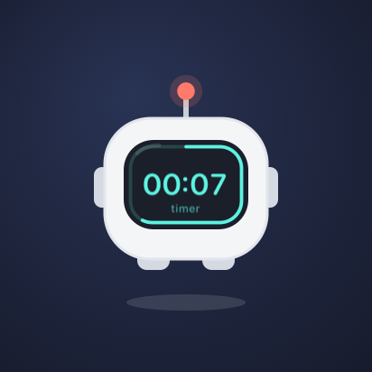
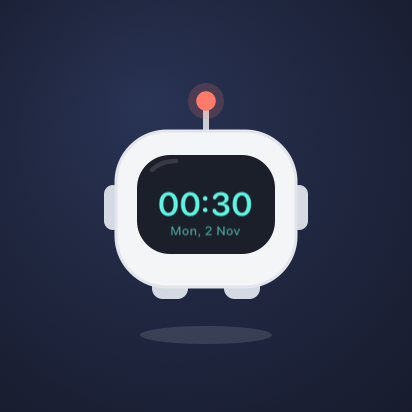
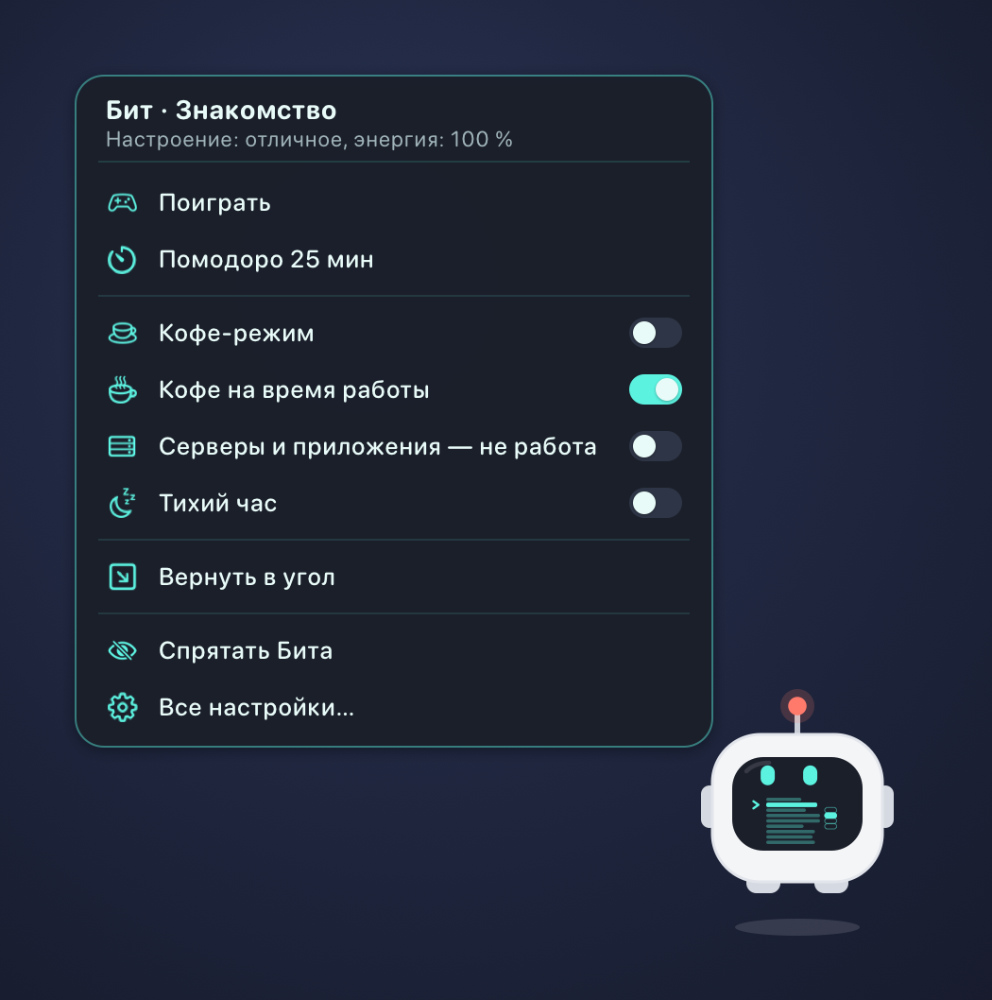

# MyPetBit

**Русский** · [English](README.en.md) · [简体中文](README.zh.md)

Бит — маленький робот-монитор, который живёт на рабочем столе macOS: следит глазами за курсором, радуется,
засыпает, когда вы отошли, и замечает, что происходит с компьютером и с вашей работой — от севшей батареи
до ответа Claude и упавшей сборки.


**Всё остаётся на вашем Mac.** Бит не ходит в сеть и ничего никуда не отправляет — подробно в разделе
[«Что Бит читает и что уходит с Mac»](#что-бит-читает-и-что-уходит-с-mac).

---

## Что умеет

**Живёт своей жизнью.** Парит, моргает, смотрит на курсор; скучно — читает, играет в тетрис и гонки, боксирует,
поднимает гантели и радуется победе. Характер с привязанностью, настроением и энергией; аксессуары надевает сам —
очки, шарф, кружку, а в сезон шапку-тыкву или колпак Санты. Гладьте курсором — мурчит отдачей трекпада.

| | | | |
|:-:|:-:|:-:|:-:|
|  |  |  |  |
| читает | тетрис | бокс | гантели |
|  |  |  |  |
| гладят | спит | работает | кофе |

**Чувствует компьютер.** Батарея, зарядка, перегрев, нехватка памяти и места, сеть и VPN, звонок (становится
прозрачным и молчит), музыка, наушники, скриншоты, загрузки — короткой реакцией и значком на своём экране. Если
спокойный Mac вдруг загрузился — вырос CPU, заполнилась память или быстро уходит место на диске, — скажет об этом, назовёт
самый тяжёлый процесс и покажет на экране CPU, ОЗУ и диск в процентах.

**Работает вместе с вами.**
- Пока отвечает ИИ-агент — **Claude Code, Cursor, OpenCode, Ollama, Codex, Kimi** — Бит «работает», потом
  говорит «Claude ответил» с названием сессии; просит разрешение — на экране ладошка.
- **Долгие команды в терминале:** «Команда завершилась» или «Команда упала · код 1», кнопка ведёт в ту самую вкладку.
  Команду можно прервать из меню Бита.
- Пока идёт работа, экран не гаснет, а у Бита в руках кофе.

**Помогает держать ритм.** Помодоро и таймер на экране Бита — заводится вытягиванием антенны; часы при наведении;
встречи из Календаря за 5 минут и в начало с кнопкой «Подключиться»; напоминания о перерыве, воде и глазах
(20-20-20); итог дня вечером; тихий час.

| | | |
|:-:|:-:|:-:|
|  |  |  |
| тянете антенну — минуты | таймер | часы при наведении, щелчок — нагрузка CPU, ОЗУ и диска |

**Меню в его стиле.** Нажатие двумя пальцами на Бите — карточка с самым нужным, и на экране Бита те же пункты
строчками. В строке меню — только самое нужное (таймер, тихий час, кофе, уборка стола), всё остальное —
в окне «Настройки…» в том же стиле: реакции, работа, ритм, разрешения, рабочий стол, характер.

**Носит файлы.** Перетащите на Бита файл или несколько — «Поймал!», и он держит их (файлы пока лежат на месте).
Утащите файл с Бита в любую папку или на стол — файл переедет туда. Двумя пальцами по Биту с файлами — быстрые
действия: положить на стол, в «Загрузки» или в выбранную папку, сжать в ZIP, распаковать, «Конвертировать в…», открыть,
показать в Finder, AirDrop, в корзину или отпустить.

**Конвертирует.** Документы (odt ⇄ docx ⇄ rtf ⇄ html ⇄ txt, в PDF), Markdown (в docx, odt, html, PDF), презентации
и таблицы (pptx → PDF), картинки (jpg ⇄ png ⇄ heic, в PDF, уменьшить), PDF (сжать, склеить, страницы в PNG), видео
(сжать в HEVC или H.264, в GIF, звук в M4A) и аудио. Бит берёт лучшее из того, что есть на Mac: сама macOS;
Keynote, Pages и Numbers — с вёрсткой; LibreOffice, pandoc, ffmpeg, libwebp, ImageMagick — если установлены
(какие найдены и как поставить остальные — в «Настройки → Конвертеры»). Внутрь Бита ничего не встраивается.

**Управляет музыкой.** Зажмите Бита на полсекунды — пауза или игра; смахните двумя пальцами по трекпаду над ним
влево — следующий трек, вправо — предыдущий. На экране Бита — значок и название, после переключения он назовёт новый
трек. То же — в меню двумя пальцами. Работает с любым плеером, который сообщает системе, что играет.

**Прячется и убирается.** «Спрятать» — Бит машет и улетает вверх, а через 10 или 30 минут, час, два (или когда
позовёте) прилетает на своё место. Попросите «Убраться на столе» — расставит файлы и папки по сетке; разложите
сами и скажите «Запомнить, как стоят значки» — дальше будет расставлять так же. Таймеру можно дать название
и включить кофе-режим на его время.



При первом запуске Бит прилетает в центр экрана, машет и знакомится: пять страниц о себе, потом разрешения
и начальные настройки. Повторить — «Знакомство…» в окне настроек.

Интерфейс — на русском, английском и китайском (по языку системы).

---

## Про подпись — сразу и честно

> У проекта нет платной учётной записи разработчика Apple, поэтому приложение не нотаризовано. На чужом Mac
> Gatekeeper по умолчанию его не пропустит. Надёжный путь — **собрать из исходников** (`make install`):
> сборка на своей машине вопросов не вызывает, и вы видите код, который запускаете. Если ставите из образа,
> после копирования снимите карантин командой ниже.

## Установка

**Из исходников (рекомендуется).** Нужны macOS 14+ и Command Line Tools (`xcode-select --install`); Xcode не нужен.

```bash
git clone https://github.com/TruDevLab/MyPetBit.git
cd MyPetBit
make cert      # один раз: свой сертификат подписи — разрешения macOS не будут слетать после пересборки
make run       # собрать, поставить в /Applications и запустить
```

**Из образа.** Скачайте `MyPetBit-<версия>.dmg` со страницы релизов, перетащите MyPetBit в «Программы» и снимите карантин:

```bash
sudo xattr -r -c /Applications/MyPetBit.app
```

Команда снимает служебные пометки только с этого приложения и ничего больше не отключает. Проверить подпись:
`codesign --verify --deep --strict /Applications/MyPetBit.app` — молчит, если всё в порядке.

Бит живёт в строке меню, значка в Dock у него нет.

**Обновления.** Раз в сутки Бит проверяет релизы на GitHub; новую версию скачивает, сверяет контрольную сумму и подпись
и предлагает облачком «Обновить» — подменит себя и перезапустится, пароль не нужен. Копия, собранная без `make cert`,
сама не обновляется: Бит даст ссылку на образ.

## Подключить ИИ-агентов и терминал

Проще всего — кнопкой: **Настройки → Интеграции → «Подключить всё найденное»** (или в знакомстве). Бит сам пропишет хуки
в найденные агенты и `~/.zshrc`, тронет только свои записи и перед первой правкой положит рядом копию `.bak-mypetbit`;
переложите приложение — пути он починит сам. Вручную — шаблоны в папке [`integrations/`](integrations), путь в них —
`/Applications/MyPetBit.app`.

| Что | Куда |
|---|---|
| Claude Code | блок `hooks` из `integrations/claude/settings.json` — в `~/.claude/settings.json` |
| Cursor | `integrations/cursor/hooks.json` → `~/.cursor/hooks.json` |
| OpenCode | `integrations/opencode/mypetbit.js` → `~/.config/opencode/plugins/` |
| Codex | строка из `integrations/codex/config.toml` → `~/.codex/config.toml` |
| Kimi CLI / Kimi Code | блоки из `integrations/kimi/config.toml` → `~/.kimi/config.toml` или `~/.kimi-code/config.toml` |
| Ollama | ничего: Бит видит, когда модель отвечает, по нагрузке её процесса |
| Терминал (код выхода) | строка `source "/путь/к/MyPetBit/tools/mypetbit.zsh"` в `~/.zshrc`; без неё Бит тоже видит долгие команды, но без кода выхода |

Любой скрипт может сказать что-нибудь Битом: `/Applications/MyPetBit.app/Contents/MacOS/MyPetBit --say "Сборка готова"`.

## Что Бит читает и что уходит с Mac

**О вас наружу не уходит ничего:** телеметрии и аналитики нет. Единственный запрос в сеть — раз в сутки Бит спрашивает
у GitHub, не вышла ли новая версия (`api.github.com/repos/TruDevLab/MyPetBit/releases/latest`, без данных о вас);
выключается в «Настройки → Бит → Проверять обновления». Файл уходит, только если вы сами отправили его через AirDrop. Всё, что Бит узнаёт, остаётся
в памяти процесса и в его настройках (`~/Library/Preferences/com.trudevlab.mypetbit.plist`).

Что он читает, чтобы реагировать:
- **показания системы** — батарея, загрузка процессора, сеть, место на диске, камера и микрофон (только «включены
  ли», не изображение и не звук), устройство вывода звука;
- **буфер обмена** — только счётчик изменений и типы данных, содержимое не читается;
- **процессы вашего пользователя** — чтобы заметить долгую команду в терминале и нагрузку Ollama; имена и аргументы
  команд показываются только в облачке;
- **журнал сессии Claude Code** — хвост файла, чтобы взять название сессии;
- **что играет** — название, исполнитель и плеер, через встроенного помощника (только чтобы показать трек и управлять им);
- **по вашему разрешению:** Календарь (встречи на ближайшие минуты), папка «Загрузки» (имена новых файлов),
  Универсальный доступ (только частота нажатий, не клавиши), управление Терминалом или iTerm (переключить вкладку
  по кнопке «Открыть») и Finder (расставить значки на столе, когда попросите). Всё это выключено, пока вы не включите сами.

## Требования и ограничения

- macOS 14 Sonoma или новее. Образ — для Apple Silicon; на Intel — сборка из исходников.
- Отдача трекпада ощущается только на Force Touch и только пальцем на трекпаде.
- Код выхода команды известен только с хуком zsh; у других оболочек — по процессам, без кода.
- Codex сообщает только о конце ответа, поэтому «работает» для него не показывается. У чат-приложения Kimi хуков нет.
- Без своего сертификата (`make cert`) macOS переспрашивает разрешения после каждой пересборки.
- Музыка работает через закрытый системный MediaRemote: с macOS 15.4 он отвечает только процессам с идентификатором
  `com.apple.controlcenter.*`, поэтому внутри Бита лежит помощник с таким идентификатором (как у Trunook). Если Apple
  закроет и это, перестанет работать только управление музыкой.
- Конвертация берёт то, что есть на Mac: pptx без Keynote или LibreOffice не конвертируется, mkv и webm — без ffmpeg.

## Разработка

Как всё устроено, все реакции и флаги для проверки — в [DEVELOPMENT.md](DEVELOPMENT.md) (на русском).
`make test` — тесты логики. Перевод: ключ — русская строка, переводы — `Resources/en.lproj` и `Resources/zh-Hans.lproj`.

## Лицензия

[MIT](LICENSE).
