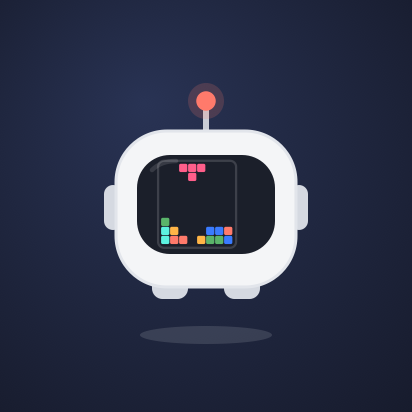
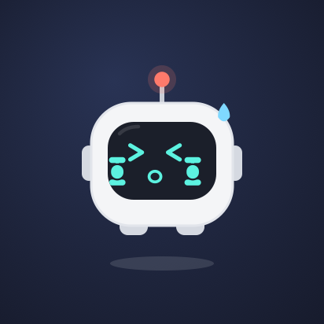
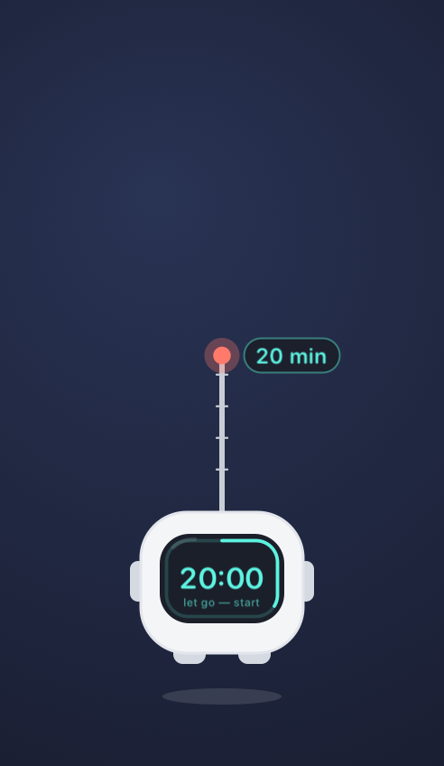
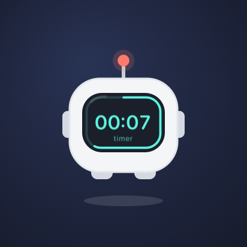
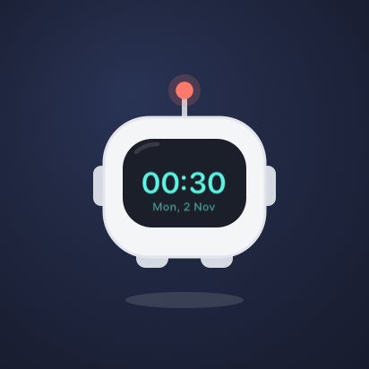
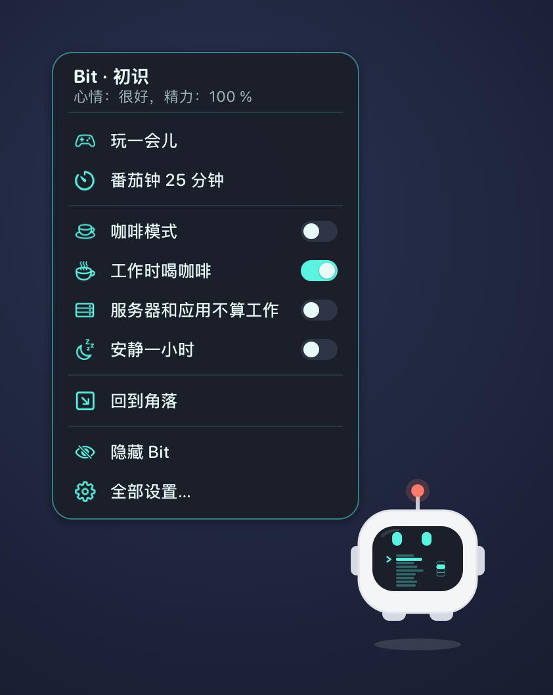

# MyPetBit

[Русский](README.md) · [English](README.en.md) · **简体中文**

Bit 是一个住在 macOS 桌面上的小显示器机器人：眼睛跟着光标转，会开心，你离开时会睡着，
还会留意电脑和你的工作发生了什么——从电量告急，到 Claude 回答完毕或构建失败。


**一切都留在你的 Mac 上。** Bit 不联网，也不向任何地方发送数据——详见
[“Bit 读取什么，什么会离开 Mac”](#bit-读取什么什么会离开-mac)。

---

## 功能

**有自己的生活。** 漂浮、眨眼、看着光标；无聊时会读书、玩俄罗斯方块和赛车、打拳击、举哑铃，赢了会庆祝。
有亲密度、心情和精力；会自己挑配饰——眼镜、围巾、马克杯，应季时戴南瓜帽或圣诞帽。用光标抚摸它，
它会通过触控板“呼噜”。

| | | | |
|:-:|:-:|:-:|:-:|
|  |  |  |  |
| 读书 | 俄罗斯方块 | 拳击 | 哑铃 |
|  |  |  |  |
| 被抚摸 | 睡觉 | 工作中 | 咖啡 |

**感知电脑。** 电池、充电、过热、内存和磁盘不足、网络和 VPN、通话（变得半透明并保持安静）、音乐、耳机、
截图、下载——用简短的反应和屏幕上的小图标告诉你。如果原本空闲的 Mac 突然变忙——CPU 飙升、内存快满或磁盘空间迅速减少——
Bit 会告诉你，说出最占资源的进程，并在屏幕上以百分比显示 CPU、内存和磁盘。

**和你一起工作。**
- AI 助手回答时——**Claude Code、Cursor、OpenCode、Ollama、Codex、Kimi**——Bit 处于“工作中”，结束后说
  “Claude 已回复”并显示会话名称；助手请求权限时，屏幕上出现一只小手。
- **终端中的长命令：** “命令已完成”或“命令失败 · 退出码 1”，按钮直接切到那个标签页。正在运行的命令可以从
  Bit 的菜单中断。
- 有工作在进行时，屏幕不会熄灭，Bit 手里端着咖啡。

**帮你保持节奏。** Bit 屏幕上的番茄钟和计时器——拉动天线即可设定；悬停显示时钟；日历会议提前 5 分钟和开始时
提醒，并带“加入”按钮；休息、喝水和护眼（20-20-20）提醒；晚间当日总结；安静一小时。

| | | |
|:-:|:-:|:-:|
|  |  |  |
| 拉动天线——设定分钟 | 计时器 | 悬停显示时钟，点一下——CPU、内存和磁盘负载 |

**它自己风格的菜单。** 在 Bit 上双指点按，会弹出只含常用项的卡片，Bit 的屏幕上也会以小横线显示同样的条目。
菜单栏菜单只保留最常用的（计时器、安静一小时、咖啡、整理桌面），其余都在同样风格的“设置…”窗口里：
反应、工作、节奏、权限、桌面、性格。

**会拿文件。** 把一个或多个文件拖到 Bit 身上——“接到了！”——它就拿着（文件暂时留在原处）。把文件从 Bit 身上
拖到任意文件夹或桌面，文件就会移动过去。拿着文件时双指点按 Bit，会出现快捷操作：放到桌面、“下载”或指定文件夹，
压缩为 ZIP、解压、“转换为…”、打开、在访达中显示、隔空投送、移到废纸篓或松手。

**会转换格式。** 文档（odt ⇄ docx ⇄ rtf ⇄ html ⇄ txt，转 PDF）、Markdown（转 docx、odt、html、PDF）、演示文稿和表格
（pptx → PDF）、图片（jpg ⇄ png ⇄ heic，转 PDF，缩小）、PDF（压缩、合并、页面转 PNG）、视频（压缩为 HEVC 或 H.264，
转 GIF，提取 M4A 音频）和音频。Bit 会选用 Mac 上现有的最佳工具：macOS 本身；Keynote、Pages 和 Numbers——保留排版；
LibreOffice、pandoc、ffmpeg、libwebp、ImageMagick——如果已安装（找到了哪些、如何安装其余的——见“设置 → 转换器”）。
Bit 本身不内置任何转换器。

**控制音乐。** 按住 Bit 半秒——暂停或播放；在它上方用双指在触控板上向左轻扫——下一首，向右——上一首。Bit 的屏幕会显示
图标和曲名，切换后它会说出新曲目。双指菜单里也有这些操作。支持任何向系统报告正在播放内容的播放器。

**会躲起来，也会整理。** “隐藏”——Bit 挥挥手飞出屏幕上方，10 或 30 分钟、1 或 2 小时后（或你叫它时）飞回原位。
让它“整理桌面”，它会把文件和文件夹按网格排好；你也可以自己摆好，然后选“记住图标的位置”——以后它会照这样摆放。
计时器可以起名字，并在计时期间保持咖啡模式。



首次启动时，Bit 会飞到屏幕中央挥手打招呼并做自我介绍：五页介绍它的功能，然后是权限和初始设置。
想再看一遍——设置窗口中的“介绍…”。

界面支持俄语、英语和中文（跟随系统语言）。

---

## 关于签名——先说清楚

> 本项目没有付费的 Apple 开发者账户，因此应用未经公证。在别人的 Mac 上，Gatekeeper 默认会拦截它。
> 可靠的方式是**从源码构建**（`make install`）：在自己机器上构建的应用不会被拦截，你也能看到自己运行的代码。
> 如果从磁盘映像安装，复制后请用下面的命令移除隔离属性。

## 安装

**从源码（推荐）。** 需要 macOS 14+ 和命令行工具（`xcode-select --install`），不需要 Xcode。

```bash
git clone https://github.com/TruDevLab/MyPetBit.git
cd MyPetBit
make cert      # 只需一次：创建自己的签名证书，重新构建后 macOS 权限不会丢失
make run       # 构建、安装到 /Applications 并启动
```

**从磁盘映像。** 在 Releases 页面下载 `MyPetBit-<版本>.dmg`，把 MyPetBit 拖到“应用程序”，然后移除隔离属性：

```bash
sudo xattr -r -c /Applications/MyPetBit.app
```

该命令只移除这个应用的扩展属性，不会关闭其他任何保护。检查签名：
`codesign --verify --deep --strict /Applications/MyPetBit.app`——一切正常时没有输出。

Bit 住在菜单栏里，没有 Dock 图标。

**更新。** Bit 每天检查一次 GitHub 上的版本发布；发现新版本后会下载、验证校验和与签名，并在气泡中提示“更新”——它会替换自己并重启，
无需密码。没有用 `make cert` 构建的副本不会自动更新：Bit 会给出磁盘映像的链接。

## 接入 AI 助手和终端

最简单的是点按钮：**设置 → 集成 →“连接找到的全部”**（或在介绍中）。Bit 会把钩子写入找到的助手和 `~/.zshrc`，只改自己的条目，
首次修改前会留一份 `.bak-mypetbit` 备份；移动应用后它会自己修复路径。手动方式——[`integrations/`](integrations) 中的模板，
路径指向 `/Applications/MyPetBit.app`。

| 对象 | 放到哪里 |
|---|---|
| Claude Code | `integrations/claude/settings.json` 中的 `hooks` 块 → `~/.claude/settings.json` |
| Cursor | `integrations/cursor/hooks.json` → `~/.cursor/hooks.json` |
| OpenCode | `integrations/opencode/mypetbit.js` → `~/.config/opencode/plugins/` |
| Codex | `integrations/codex/config.toml` 中的那一行 → `~/.codex/config.toml` |
| Kimi CLI / Kimi Code | `integrations/kimi/config.toml` 中的块 → `~/.kimi/config.toml` 或 `~/.kimi-code/config.toml` |
| Ollama | 无需配置：Bit 根据模型进程的负载判断它是否在回答 |
| 终端（退出码） | 在 `~/.zshrc` 中加入 `source "/path/to/MyPetBit/tools/mypetbit.zsh"`；不加也能发现长命令，只是没有退出码 |

任何脚本都可以让 Bit 说话：`/Applications/MyPetBit.app/Contents/MacOS/MyPetBit --say "构建完成"`。

## Bit 读取什么，什么会离开 Mac

**不会发送任何关于你的信息：** 没有遥测或统计。唯一的网络请求是每天向 GitHub 查询一次是否有新版本
（`api.github.com/repos/TruDevLab/MyPetBit/releases/latest`，不包含任何关于你的数据）；可在“设置 → Bit → 检查更新”中关闭。
只有你自己用隔空投送发送文件时，文件才会离开。Bit 得知的一切只保存在进程内存和它的设置
（`~/Library/Preferences/com.trudevlab.mypetbit.plist`）中。

为了做出反应，它会读取：
- **系统状态**——电池、CPU 负载、网络、磁盘空间、摄像头和麦克风（只看是否开启，从不读取画面或声音）、
  音频输出设备；
- **剪贴板**——只看变更计数和数据类型，从不读取内容；
- **你的用户进程**——用来发现终端中的长命令和 Ollama 的负载；命令名称和参数只显示在气泡里；
- **Claude Code 会话日志**——只读文件末尾，用来获取会话名称；
- **正在播放的内容**——曲名、艺人和播放器，通过内置助手读取（只用于显示曲目和控制播放）；
- **经你允许后：** 日历（接下来几分钟内的会议）、“下载”文件夹（新文件的名称）、辅助功能（只统计打字速度，
  不记录按键）、控制终端或 iTerm（点击“打开”时切换到对应标签页）和访达（在你要求时整理桌面图标）。这些默认全部关闭，需要你自己开启。

## 要求与限制

- macOS 14 Sonoma 或更高版本。磁盘映像适用于 Apple Silicon；Intel 机型请从源码构建。
- 触控板触感反馈仅在 Force Touch 触控板上、手指放在触控板上时才能感觉到。
- 只有使用 zsh 钩子时才能知道命令的退出码；其他 shell 通过进程跟踪，没有退出码。
- Codex 只通知回答结束，因此不会显示“工作中”。Kimi 聊天应用没有钩子。
- 没有自己的证书（`make cert`）时，每次重新构建后 macOS 都会再次请求权限。
- 音乐控制使用私有的 MediaRemote 框架：自 macOS 15.4 起它只响应标识符以 `com.apple.controlcenter.` 开头的进程，
  因此 Bit 内带一个使用此类标识符的小助手（与 Trunook 相同）。如果 Apple 也封堵这一途径，只有音乐控制会失效。
- 格式转换依赖 Mac 上已有的工具：pptx 需要 Keynote 或 LibreOffice，mkv 和 webm 需要 ffmpeg。

## 开发

整体结构、所有反应和调试参数见 [DEVELOPMENT.md](DEVELOPMENT.md)（俄语）。`make test` 运行逻辑测试。
翻译：键是俄语原文，译文位于 `Resources/en.lproj` 和 `Resources/zh-Hans.lproj`。

## 许可证

[MIT](LICENSE)。
